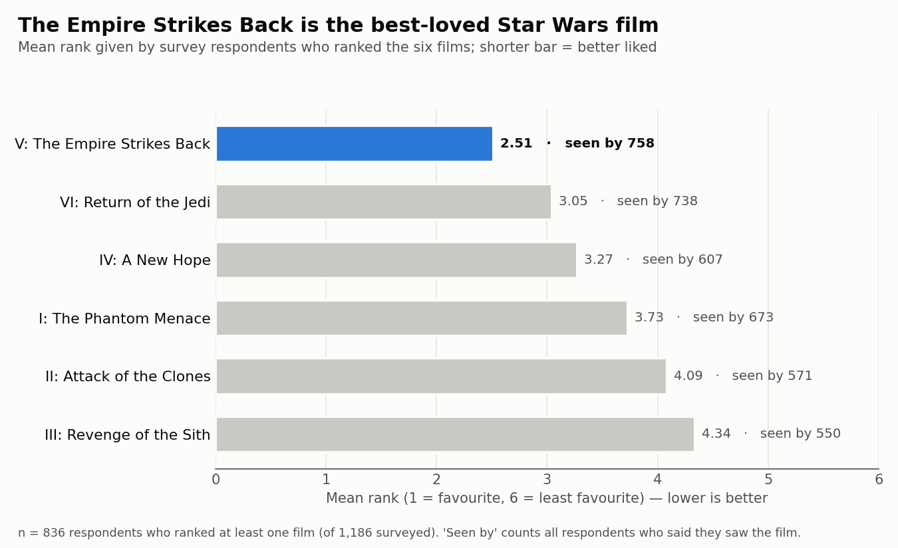
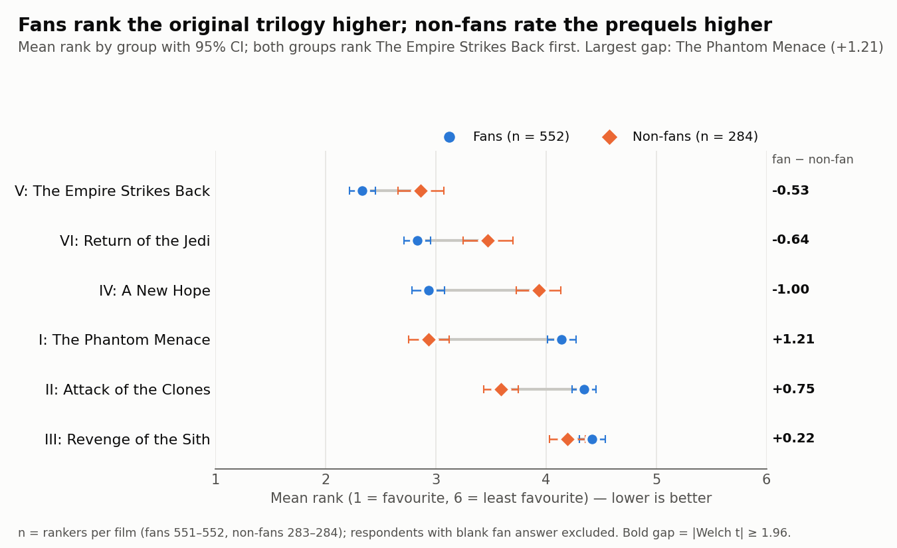
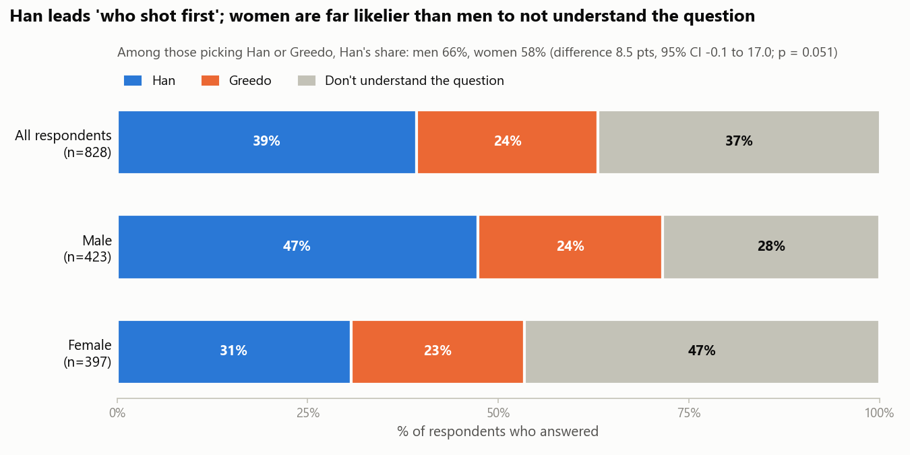

# Star Wars survey: findings

**Data:** the FiveThirtyEight "Star Wars" survey, which has 1,186 respondents (`data/raw/StarWars.csv`).

**Sources:** every number below comes from the output of `src/clean.py`, `src/analysis_films.py` and `src/analysis_shot_first.py`, or from `outputs/films_results.json` and `outputs/shot_first_results.json`. The numbers were also checked independently by `tests/test_data.py`, which passes 57 of 57 tests.

**Who answered what:** 835 respondents ticked at least one film as seen. 836 ranked at least one film: 834 gave a complete 1–6 ranking and 2 ranked 5 of the 6 films.

---

## Q1. Which film is the most liked?

**The Empire Strikes Back (Episode V)** is the clear favourite. It has the best mean rank (**2.513**, where 1 = favourite), the most #1 votes (**289**, or 34.6% of rankers) and the largest audience (**758** people have seen it).

| Film | Mean rank | Median | Ranked #1 | Seen by | % of the 835 who saw any film |
|---|---|---|---|---|---|
| V: The Empire Strikes Back | **2.513** | 2 | 289 (34.6%) | 758 | 90.8% |
| VI: Return of the Jedi | 3.048 | 3 | 146 (17.5%) | 738 | 88.4% |
| IV: A New Hope | 3.273 | 3 | 204 (24.4%) | 607 | 72.7% |
| I: The Phantom Menace | 3.733 | 4 | 129 (15.4%) | 673 | 80.6% |
| II: Attack of the Clones | 4.087 | 4 | 32 (3.8%) | 571 | 68.4% |
| III: Revenge of the Sith | 4.341 | 5 | 36 (4.3%) | 550 | 65.9% |

Each film has 835–836 ranks.

The original trilogy (IV–VI) takes the top three places and the prequels (I–III) the bottom three.

**Sensitivity check:** the survey let people rank films they had not seen, and **1,118** ranks are for films the respondent did not tick as seen. When the analysis is restricted to the **471** respondents who saw all six films:
- The winner is unchanged: Empire still leads with a mean rank of 2.38.
- A New Hope moves up to second (2.866), ahead of Return of the Jedi (2.932).
- The full order is V > IV > VI > I > III > II.

## Q2. Do fans and non-fans rank the films differently?

**Yes.** There are 552 fans and 284 non-fans in this comparison. The 350 people who were not asked, or left the question blank, are excluded.
- Both groups put **Empire first**.
- **Fans** rank the original trilogy much higher and the prequels much lower.
- **Non-fans** put **The Phantom Menace second**, and they rank A New Hope fifth.

| Film | Fans: mean rank (95% CI) | Non-fans: mean rank (95% CI) | Fan − non-fan | Welch t |
|---|---|---|---|---|
| I: The Phantom Menace | 4.141 (4.012–4.271) | 2.936 (2.754–3.119) | **+1.205** | 10.56 |
| II: Attack of the Clones | 4.342 (4.233–4.451) | 3.592 (3.435–3.748) | +0.751 | 7.73 |
| III: Revenge of the Sith | 4.417 (4.300–4.535) | 4.194 (4.033–4.355) | +0.224 | 2.20 |
| IV: A New Hope | 2.933 (2.785–3.081) | 3.933 (3.731–4.135) | **−1.000** | −7.82 |
| V: The Empire Strikes Back | 2.333 (2.214–2.453) | 2.863 (2.656–3.070) | −0.529 | −4.34 |
| VI: Return of the Jedi | 2.830 (2.708–2.951) | 3.472 (3.246–3.698) | −0.642 | −4.90 |

Rank order, best to worst:
- **Fans:** V > VI > IV > I > II > III
- **Non-fans:** V > I > VI > II > IV > III

Every gap has |t| > 1.96. The largest are The Phantom Menace (+1.2 ranks; fans like it less) and A New Hope (−1.0; fans like it more). Revenge of the Sith is borderline (t = 2.20).

## Q3. Who shot first, and does the answer differ by gender?

**Han** is the most common answer. Of the 828 people who answered:

| Answer | Count | Share |
|---|---|---|
| Han | 325 | 39.3% |
| Greedo | 197 | 23.8% |
| "I don't understand this question" | 306 | 37.0% |

Among the 522 who chose a side, **62.3% said Han** and 37.7% said Greedo.

| Gender | n answered | Han | Greedo | Don't understand | Han share of Han+Greedo |
|---|---|---|---|---|---|
| Male | 423 | 200 (47.3%) | 103 (24.3%) | 120 (28.4%) | 66.0% (n=303) |
| Female | 397 | 122 (30.7%) | 90 (22.7%) | 185 (46.6%) | 57.5% (n=212) |

The 8 answerers with no gender recorded are excluded from this comparison.

- **The answers do differ by gender**: χ² = 32.83, df = 2, p = 7.4×10⁻⁸, Cramér's V = 0.20. Almost all of the difference comes from **"don't understand"**, which 46.6% of women chose against 28.4% of men.
- **Among people who picked a side**, men lean slightly more towards Han, but the gap is not statistically clear:
  - Han share: 66.0% of men vs 57.5% of women, a difference of +8.5 points (95% CI −0.1 to +17.0).
  - χ² = 3.81, df = 1, p = 0.051, V = 0.086.
- **Conclusion:** men and women who know the scene answer much the same, and both say Han. The real gender difference is in familiarity with the question.

---

## Data problems fixed

The full list, with evidence for each problem, is in `PLAN.md`; the cleaning code is `src/clean.py`.

1. **Encoding:** the file is not UTF-8. It is read as cp1252.
2. **Garbage in a column name:** two mojibake bytes (`0x8c 0xe6`) follow "...fan of the Expanded Universe?". All columns are renamed by position, and the original headers are checked against what we expect.
3. **Second header row inside the data:** the "Response" / film-name row is used to check the column mapping, then dropped.
4. **23 `Unnamed: N` columns:** each was given a meaningful snake_case name. The result is 40 clean columns.
5. **"Which films have you seen" spread across 6 columns** (film title or blank): converted to booleans `seen_ep1`–`seen_ep6`, plus a derived `seen_count`.
6. **Double spaces in film titles,** where a dash had been stripped: whitespace is normalised before the column-mapping check.
7. **Rankings stored as text:** converted to integers 1–6. Each complete ranking was checked to be a permutation of 1–6.
8. **Two partial rankings:** two respondents ranked 5 of the 6 films. Their ranks were kept and the row is flagged `rank_complete = False`.
9. **Yes/No stored as strings:** five questions were converted to nullable booleans. Any unexpected value stops the run with an error.
10. **Long text categories:** shot-first, character favourability, gender, age, income, education and region were recoded to short labels. "I don't understand this question" is kept as its own category (`dont_understand`).
11. **Skip-logic blanks:** these were kept as missing, not imputed. Assertions confirm that nobody who answered "No" to "seen any film" answered any later film question.
12. **Apparent duplicates:** 142 rows are identical apart from the ID, but they are different, mostly blank respondents. IDs are unique, so no rows were removed.
13. **Raw file protected:** `.gitattributes` stops Git converting its line endings. A test pins its SHA-256 hash.

**Row count:** 1,187 parsed rows went in and 1,186 respondents came out (only the sub-header row was dropped).

## Limitations

- **Missing answers:** 350 respondents gave no ranking and no fan answer. Of these, 250 had seen no film, and 100 said they had seen one but ticked no films and answered nothing more (101 said "Yes" but ticked none; 1 of them still ranked the films). Shot-first is blank for 358 people and gender for 140. Each figure uses only the people who answered that question, so the Ns differ between sections.
- **Ranking unseen films:** 1,118 ranks are for films the respondent said they had not seen. The ranking therefore partly measures reputation, not only the experience of watching. The headline result holds when only the 471 who saw all six films are counted, but the order of IV and VI changes.
- **Fan status is self-described:** the question was only asked of people who had seen a film, so "non-fans" here are people who have seen at least one film but don't call themselves fans.
- **Survey bias:** this is an online SurveyMonkey panel run by FiveThirtyEight in 2014. It is not a probability sample, and the Star Wars questions were answered only by the respondents who had seen a film. Results describe these respondents, not the general population. The data has no weights, and the CIs and tests assume simple random sampling.
- **Timing:** the survey predates Episodes VII–IX, so the "most liked" result covers only Episodes I–VI.
- **Mean rank on an ordinal scale:** mean rank treats the distance between each rank as equal. The share of #1 votes and the medians point the same way (Empire first).
- **Possible misreading of the shot-first question:** "Don't understand" may also absorb people who know the scene but not the "Han shot first" controversy.
